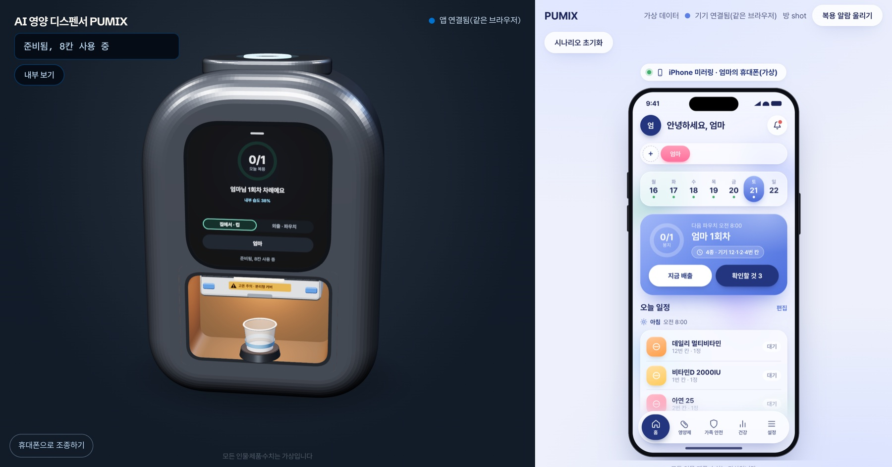
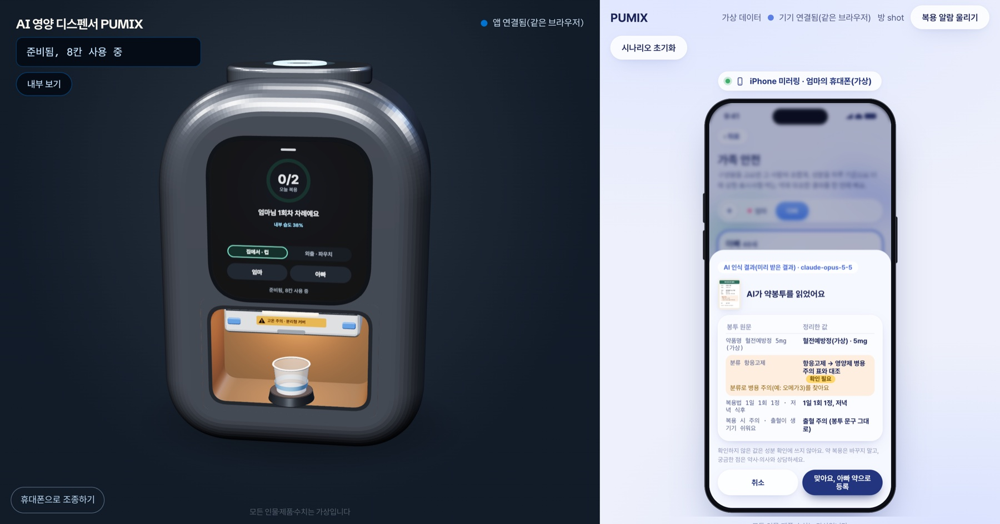
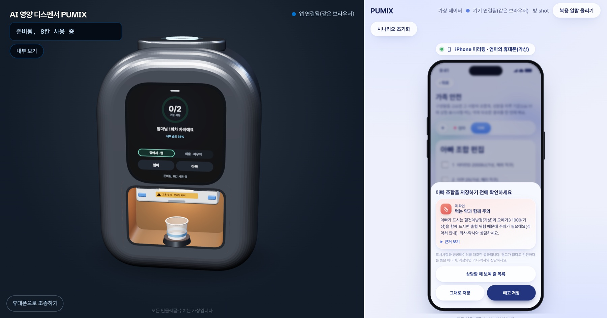
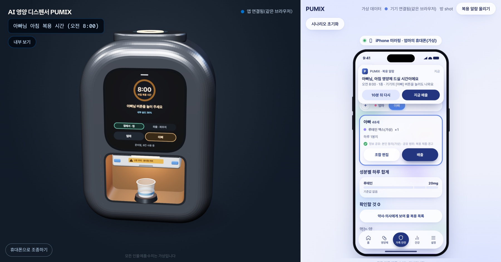
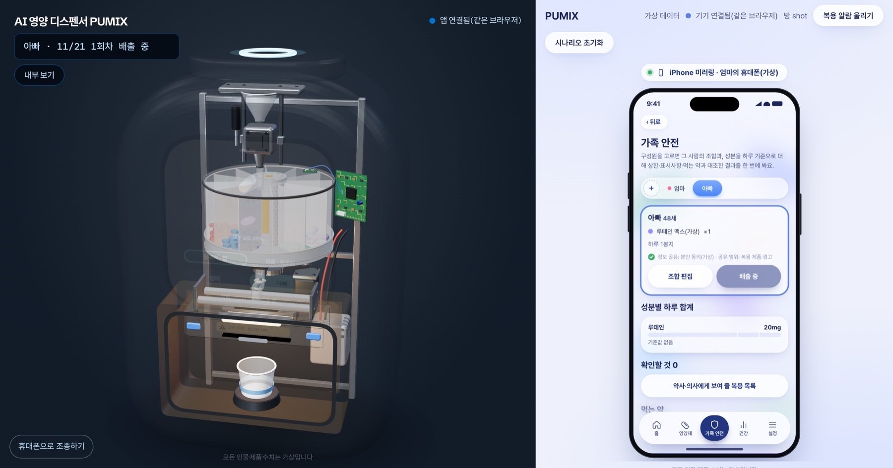
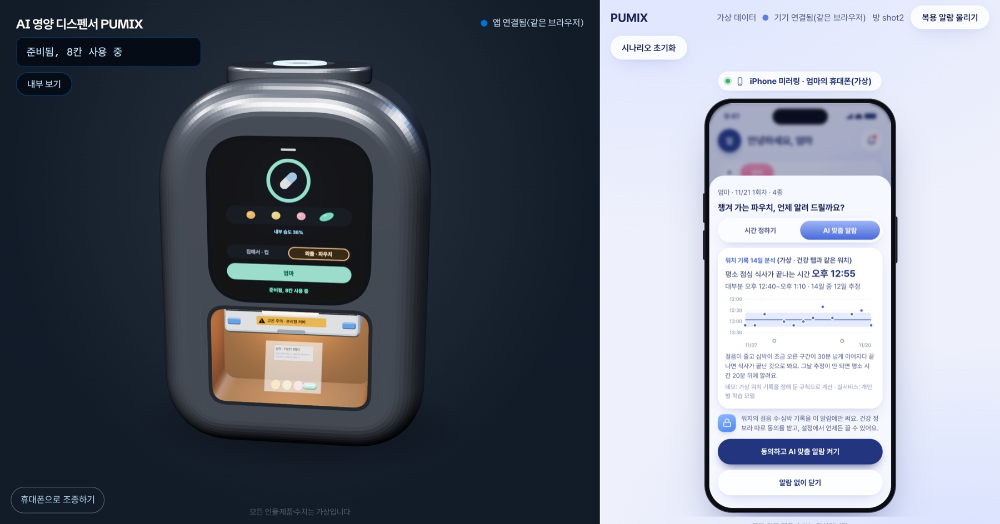
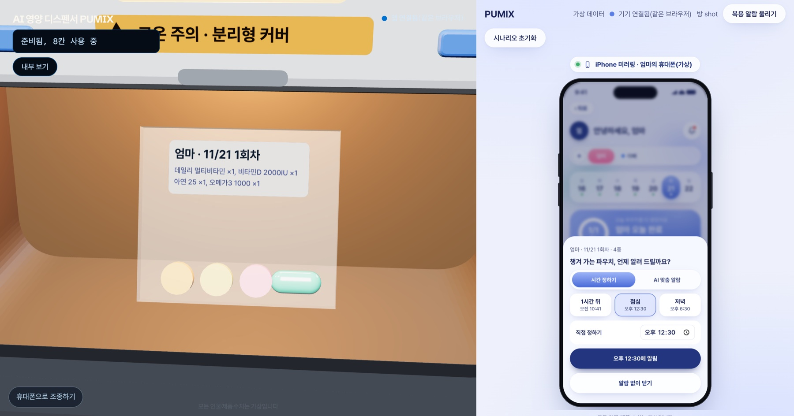
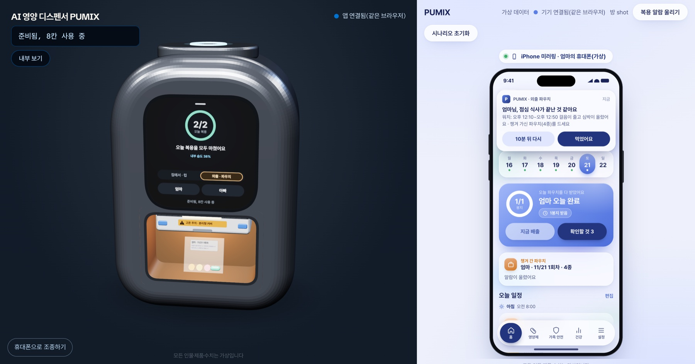
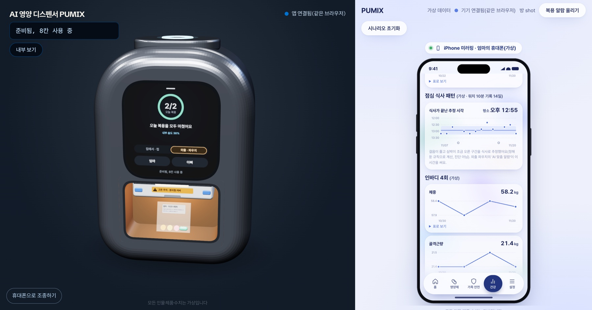

# PUMIX — 가족 영양제 AI 스마트 디스펜서

<sub>Family Supplement AI Dispenser</sub>

> **"병 아홉 개 대신, 버튼 하나."**
>
> 가족이 각자 산 시중 영양제를 넣으면 성분 중복·알레르기·먹는 약과의 병용 주의를 **먼저 확인**하고,
> 버튼 하나로 사람별 하루치를 컵이나 밀봉 파우치로 내주는 AI 스마트 디스펜서 기획과 동작하는 웹 데모.
> 2026 마산대학교 × 연암공과대학교 AI 헬스케어 해커톤 **대상(경상남도지사상) 수상작**.



<p align="center">
  <a href="https://kdg-04.github.io/2026-Masan-Yeonam-AI-Healthcare-Hackathon/demo/"><b>라이브 데모</b></a>
  &nbsp;·&nbsp;
  <a href="docs/PUMIX-presentation.pdf">발표 자료</a>
  &nbsp;·&nbsp;
  <a href="docs/service-plan.md">서비스 기획서</a>
  &nbsp;·&nbsp;
  <a href="docs/demo-script.md">시연 대본</a>
</p>

| | |
|---|---|
| **프로젝트명** | PUMIX(퓨믹스) |
| **행사** | 2026 마산대학교 × 연암공과대학교 AI 헬스케어 해커톤 |
| **일자** | 2026년 11월 20일 ~ 21일 (1박 2일) |
| **결과** | 🏆 **대상** · 경상남도지사상 |
| **팀** | CODEBLUE · 6인 (마산대 보건행정과 3 · 연암공대 스마트소프트웨어과 3) |
| **내 역할** | **PM · 발표** — 기획·범위 관리, 서비스 기획서·데모 명세서 정리, 데모 기능 개발, 최종 PT 발표·라이브 시연 |
| **팀원** | 이0경 (팀장 · 발표) · 배0애 (발표 자료) · 신0희 (자료 조사) · 박0희 (Frontend) · 안0현 (Backend) |
| **산출물** | 발표 자료 + 동작하는 웹 데모 (3D 기기 + 휴대폰 앱) |
| **개발 방식** | 해커톤 MVP · 빌드 없는 정적 웹 · AI 코딩 도구(Claude Code) 활용 |

> ### ⚠️ 이 저장소에 대하여
>
> - `demo/`는 **팀 공동 작업**이며, 팀원 동의를 받아 함께 공개한다. 내가 만든 부분은 [5절](#5-내가-맡은-것--pm--발표)에 정리했다.
> - 모든 인물·제품·수치는 **가상 데이터**다. 실물 기기는 만들지 않았고 3D 화면으로 대신했다.
> - 라벨·약봉투 판독은 비전 모델로 **실제로 읽은 결과를 저장해** 보여 준다. 화면에서 매번 AI를 부르지 않는다.
> - 공개본은 팀 서버(Supabase) 설정을 빼서 **같은 브라우저 안에서만** 앱과 기기가 연결된다.
> - 서비스는 진단·처방을 대신하지 않는다. 경고는 표시사항과 공공 기준을 대조한 결과이며, 판단은 약사·의사에게 맡긴다.

### 바로 보기

| | |
|---|---|
| ▶ **라이브 데모** | [열기](https://kdg-04.github.io/2026-Masan-Yeonam-AI-Healthcare-Hackathon/demo/) — 왼쪽 3D 기기 + 오른쪽 앱, 크롬 권장 |
| 🎞 **발표 자료** | [PDF](docs/PUMIX-presentation.pdf) — 15장 (방송 화면 캡처 장은 저작권 때문에, 팀원 실명이 적힌 장은 개인정보 때문에 뺐다) |
| 📄 **서비스 기획서** | [보기](docs/service-plan.md) — 문제·고객·기능·사업성 |
| 🎤 **시연 대본** | [보기](docs/demo-script.md) — 최종 PT 시연 순서와 말한 것 |

---

## 1. 문제

| 근거 | 내용 | 출처 |
|---|---|---|
| 구매 경험률 83.6% | 건강기능식품 구매 가구가 2021년 대비 2025년 약 142만 가구 증가 | 한국건강기능식품협회 |
| 2개 이상 섭취 54~62% | 섭취자 중 2개 이상 먹는 비율 남 54.42%, 여 62.34% | 2018~2020 국민건강영양조사 (JNH 2025;58(4) 인용) |
| 5명 중 1명꼴 성분 중복 | 2개 이상 섭취자 중 아연 21.78%, 비타민D 20.34%가 같은 성분 중복 | 같은 논문 |
| 먹는 약과의 병용 주의 | EPA·DHA(오메가3) + 항응고제, 프로바이오틱스 + 항생제 | 식품의약품안전처 안내 |

가족 영양제는 보통 한 사람이 사고 챙긴다. 발표에서는 45세 최은정 씨(가상)로 설명했다.
종합비타민에 비타민D·아연이 들어 있는 줄 모르고 따로 사 먹고, 남편은 항응고제를 먹는데 아내의 오메가3를 같이 먹고 싶어 하고, 딸은 우유 알레르기가 있다.
**누가 무엇을 먹는지, 겹치는지, 같이 먹어도 되는지**를 한 사람이 머릿속으로 관리하고 있다.

---

## 2. 아이디어 발전 과정

- 첫 안은 퇴원 환자 연결 서비스였으나 폐기하고, **가족이 이미 산 시중 영양제를 넣는 디스펜서**로 바꿨다.
- 비슷한 기기를 먼저 조사했다. 자사 영양제 전용 카트리지형 기기는 이미 있고, 시중 영양제를 부어 넣는 기기도 개발 중(같은 나이대 조합 추천 지향)이었다. 그래서 '국내 최초'라는 말은 쓰지 않고, 차별점을 **이미 산 영양제 + 먹는 약 + 알레르기를 함께 확인**하는 것으로 잡았다.
- **추천하지 않고 경고만** 한다는 원칙을 정했다. 경고 판단은 공공 기준과 규칙표, AI는 읽고 설명하는 일만 한다.
- 이름은 영양지기 → 영양짝꿍 → **PUMIX**(Personal + Unique + Mix)로 바뀌었다. 보관은 칸 안 습도만 관리하는 쪽으로 단순화했다.

---

## 3. 해결 방식

**3대 핵심 기능 — 넣으면 읽고, 먼저 확인하고, 버튼 하나로 내준다**

1. **넣으면 읽고 정리** — 라벨(해외 직구 영문 포함)·약봉투를 사진으로 읽고, 자신 없는 항목은 '확인 필요'로 남긴다. 가운데 투입통에 부으면 빈 칸으로 옮겨 담는다.
2. **가족마다 먼저 확인** — 구성원별 성분 하루 합계와 상한 대비 %, 알레르기 표시, 먹는 약 병용 주의를 근거와 함께 알려 주고, 약사·의사에게 보여 줄 상담용 복용 목록을 만든다.
3. **버튼 하나로 사람별 배출** — 기기 버튼이나 앱에서 그 사람 몫만 내준다. 집에서는 컵에, 외출할 때는 이름·회차가 찍힌 밀봉 파우치로.

**AI가 하는 일 / 하지 않는 일**

| 한다 | 하지 않는다 |
|---|---|
| 사진에서 제품명·함량·약품 정보 읽기 | 제품·효능 추천 |
| 경고를 쉬운 말로 설명 | 질병 판단, 복용 조정 |
| 워치 기록으로 알림 시점 추정 (AI 맞춤 알람) | 경고 판단 (규칙과 공공 기준이 한다) |

---

## 4. 데모 화면

| 장면 | 화면 |
|---|---|
| AI 약봉투 판독 — 항응고제를 '확인 필요'와 함께 정리 |  |
| 병용 주의 — 항응고제 + 오메가3, 식약처 근거와 상담 안내 |  |
| 복용 알람 — 휴대폰 배너 + 기기 뚜껑 링·구성원 버튼 깜빡임 |  |
| 원터치 배출 — 칸이 돌고 슈트로 내려와 컵에 담김 (속 보기) |  |
| 외출 파우치 + AI 맞춤 알람 — 워치 기록 14일로 평소 점심 식사가 끝나는 시간 |  |
| 파우치 확대 — 이름·회차 라벨과 알약 |  |
| "점심 식사가 끝난 것 같아요" 알람 |  |
| 건강 탭 — 워치 기록으로 본 점심 식사 패턴 |  |

---

## 5. 내가 맡은 것 — PM · 발표

**PM**
- 주제 선정과 아이디어 비교, 서비스 기획서·데모 개발 명세서 정리, 유사 서비스·통계 조사
- 1박 2일 범위 관리: 만들 것과 말로만 설명할 것을 나누고, 화면 문구가 진단·추천처럼 보이지 않게 기준을 정함

**발표**
- 최종 PT 발표와 라이브 시연 진행 ([시연 대본](docs/demo-script.md))

**데모 개발** — 팀 저장소 81커밋 중 43커밋
| 영역 | 한 일 |
|---|---|
| 앱 화면 | 디자인 시안 통합, 메뉴 구조(홈·영양제·가족 안전·건강·설정), 뒤로가기, 오류가 나도 탭이 멈추지 않게 |
| AI 판독 흐름 | 라벨·약봉투 판독 화면(스캔 애니메이션·단계 표시), 민감정보 동의, '확인 필요' 표시 |
| 알람 | 복용 알람(앱 배너 + 기기 링·버튼), 외출 파우치 AI 맞춤 알람과 워치 패턴 분석 엔진(테스트 포함) |
| 배출 | 집에서(컵)/외출(파우치) 선택, 3D 기기 파우치 확대, 배출 중 알약이 몸체 밖에 보이던 버그 수정 |
| 연동 | 시나리오 초기화 때 앱·기기 상태 동기화, 여러 창이 열려도 사람이 조작한 앱을 기기가 따르게, 데모 서버 |

---

## 6. 기술 스택

| 영역 | 선택 | 이유 |
|---|---|---|
| 화면 | 정적 웹 (HTML · CSS · ES 모듈) | 빌드 없이 노트북 한 대에서 바로 시연, 오프라인 가능 |
| 3D 기기 | three.js 0.160 | 칸 회전·슈트·포장 카세트·속 보기를 실제 제품처럼 보여 주기 위해 |
| 두 화면 연결 | BroadcastChannel (+ 원본은 Supabase Realtime) | 같은 노트북의 앱·기기, 원본에서는 실제 휴대폰까지 실시간 연결 |
| 안전 엔진 | 규칙 기반 (2025 영양소 섭취기준, 병용 주의 규칙표) | 경고 판단은 설명 가능해야 함, AI는 설명만 |
| 테스트 | Node 내장 test runner, 47개 | 엔진·연결·중복 배출 방지·워치 패턴 |

---

## 7. 저장소 구성

```
2026-Masan-Yeonam-AI-Healthcare-Hackathon/
├── README.md                 이 문서
├── index.html                GitHub Pages 첫 화면 → demo/ 로 이동
├── demo/                     웹 데모 (index.html = 왼쪽 기기 + 오른쪽 앱)
│   ├── js/app · js/device · js/engine   앱 · 3D 기기 · 안전/일정/패턴 엔진
│   ├── data/                 가상 데이터 (가족·제품·워치 기록 등)
│   ├── tests/                테스트 47개 (npm test)
│   └── tools/serve.py        로컬 데모 서버
├── docs/
│   ├── PUMIX-presentation.pdf   발표 자료 공개본 (15장)
│   ├── service-plan.md       서비스 기획서
│   ├── demo-spec.md          데모 개발 명세서
│   ├── demo-architecture.md  두 화면 연결 구조
│   ├── humidity-design.md    습도 관리 설계
│   └── demo-script.md        시연 대본
└── screens/                  데모 화면 캡처
```

로컬 실행: `cd demo && python3 tools/serve.py` → `http://127.0.0.1:8000/`

---

## 8. 현재 상태

해커톤 종료 시점에서 개발이 멈춰 있다.

- 실물 기기는 만들지 않았다. 부품 단가로 원가만 추정했다(1,000대 기준 대당 85,903원, 발표 자료 부록).
- AI 판독은 미리 읽어 둔 결과를 보여 준다. 실시간 촬영·판독은 연결하지 않았다.
- AI 맞춤 알람은 가상 워치 기록을 정해 둔 규칙(걸음↓·심박↑ 30분 이상)과 통계로 계산한다. 개인별 학습 모델과 실제 워치 연동은 계획 단계다.
- 병용 주의 규칙표는 식약처 안내 몇 쌍만 담았고, 전문가 검수 전이다.

---

## 9. 참고

- 화면에 등장하는 가족·제품·수치는 모두 가상 데이터다.
- 팀원 이름은 익명 처리했다.
- 이 저장소는 개인 포트폴리오 목적으로 공개한다.
